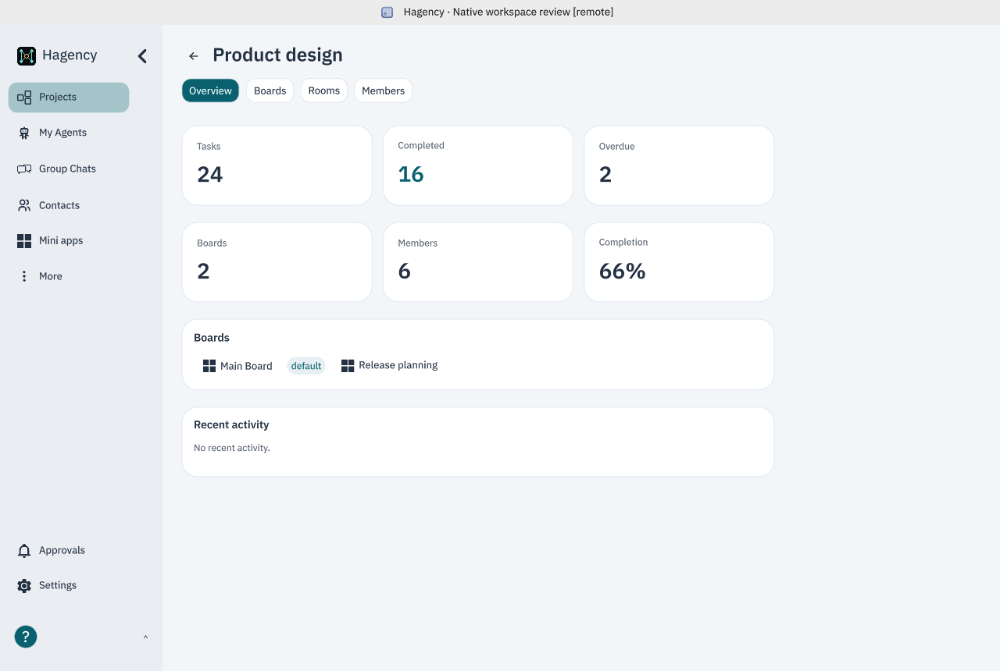

# Native workspace layout

English | [简体中文](native-layout.zh-CN.md)

The client uses Makepad for its native interface. OctoSense is a reference for
surface hierarchy, typography and consistent component recipes, rather than a
replacement renderer. The client's existing chat, Project and Agent navigation
and authorization flows remain authoritative.

## Shared rules

- `theme.rs` supplies light/dark surface roles, a restrained accent, 24 px page
  titles, 18 px card titles, 16 px section titles, 14 px body text and 12 px
  supporting text. Makepad font sizes are points, so these logical pixel sizes
  are converted by a factor of 0.75. Existing text enlargement still applies.
- `RinxLabel` has no implicit padding. Its parent owns alignment and spacing.
- `RINX_SPACE_1` through `RINX_SPACE_8` provide 4, 8, 12, 16, 20, 24 and 32
  logical pixel steps, scaled by the active theme's density.
- `RinxSection` owns card fill, border, radius, internal padding and content gap.
  `RinxToolbar` owns wrapping and action spacing. Page-specific controls extend
  these recipes instead of duplicating another palette or container style.
- `RinxListRow` uses 20 px horizontal and 12 px vertical padding, preserving
  compact rows when a Project has no description.
- `theme/layout.rs` resolves geometry from the page's allocated width, not the
  surrounding window. The base gutter is 24 on wide pages and 16 below 640;
  theme gutter and density preferences scale it. Header actions stack below 960.
  Text enlargement moves the wrapping breakpoints earlier.
- Scroll viewports reach the outside right edge. Content, cards and headers keep
  their own matching gutter; scrollbar width must not be subtracted twice.
- Forms and overview content respect the active reading-width preference. Boards
  use the full workspace and preserve their 280 px columns and scrollbar gutter.
- Overview metrics stack in narrow content areas. Titles and metrics fit their
  content height so enlarged text does not depend on a fixed line box.
- Theme reapply invalidates cached page geometry. The standalone palette never
  overwrites an external host's stylesheet; imported packages can override it.

The same surface hierarchy also covers the sidebar, chat colors, login card and
Settings. The login card is at most 480 px wide; its contents scroll on short
windows. It uses the existing authentication controls.

## Native review

From the workspace root:

```sh
cargo build --locked -p hagency-app --example workspace_preview --example project_board_preview
python3 crates/hagency-app/tools/check-native-layout.py --output /absolute/path/to/new-evidence
HAGENCY_NATIVE_CREDENTIAL_IO=deny cargo test --locked -p hagency-app --lib
python3 crates/hagency-app/tools/check_theme_literals.py
git diff --check
```

The development-only previews render production widgets with fictional content
and disposable data. They do not authenticate, contact a backend or start an
Agent. The checker retains original screenshots, widget rectangles, binary
hashes and native logs. It checks header/action bounds, gutters, list placement,
metrics, login bounds and stable board geometry across wide/narrow, light/dark,
Chinese and enlarged-text views. Inspect the PNGs as well: geometry checks alone
do not establish visual quality, working authentication or physical-device UX.

## Captured examples

These are original Makepad captures with fictional content, not design mockups.



[Dark workspace](native-layout/projects-dark.png) ·
[Production sign-in screen](native-layout/login.png) ·
[Board before](native-layout/before-board.png) ·
[Board after](native-layout/after-board.png)

The macOS review passed 886 library tests (2 existing ignored tests), all 18
native layout cases, the theme-literal guard and whitespace checks. The actual
`hagency` executable also rendered its signed-out screen and shut down cleanly
with a disposable data directory. [Validation record](native-layout/validation.json)
includes source and binary hashes, viewports and test limitations.

## Project and Agent workspaces

The current workspace layout follows the active Concraft client’s
`ui/projects/workspace.rs`, `ui/agents/workspace.rs` and `desktop.css`:

- Projects and My Agents use the same contextual navigation width (240 px by
  default, following the saved context preference), a 28 px heading row and
  adjacent refresh/new controls. The main pane shares a centered selection
  prompt and creation button. The prompt does not represent a successful read.
- Agent search projects visible rows onto their original record indices. Row
  actions recheck the displayed record ID. The directory remains visible beside
  desktop details; narrow layouts show the directory or details with Back.
- Agent service controls keep the original device and runtime checks. Pending
  commands open a scrollable main page from the directory footer and retain
  their original IDs, inputs and recovery actions.
- Chat loading notices track an actual request. Failures name group chats and
  expose Retry while existing private conversations remain visible. A 45-second
  UI deadline detaches the original read without cancelling native cleanup;
  automatic polling stops after that deadline until an explicit retry or new
  navigation. Unknown group/project membership remains excluded.

The `legacy-*` review scenes restore obsolete saved tab kinds through the real
Dock loader before rendering. `chats-loading` and `chats-error` exercise separate
loading and failure presentations. Project navigation in the standalone visual
preview uses sample rows; the production Project tree retains its authenticated
backend source. Real account navigation is checked separately in the application.

Current original Makepad review captures (fictional data):
[Projects workspace](native-layout/projects-workspace.png) ·
[My Agents workspace](native-layout/agents-workspace.png) ·
[Group-chat failure and Retry](native-layout/chats-group-error.png).
The layout revision passed 892 library tests (2 existing ignored), 61 focused
management follow-up tests, and all 34 native cases, including the original
board, sign-in and settings checks.
