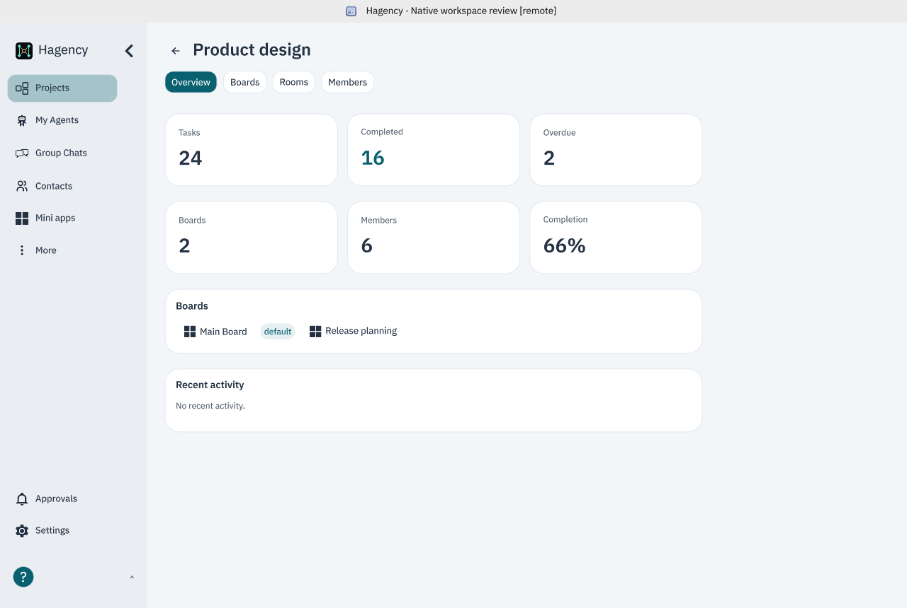

# 原生工作区布局规范

[English](native-layout.md) | 简体中文

客户端继续使用 Makepad 原生界面，参考 OctoSense 的表面层次、排版和组件规范。
聊天、项目、Agent 的导航方式及授权流程仍由现有业务实现负责。

## 共同规则

- `theme.rs` 集中定义浅色／深色表面、强调色，以及页面标题 24、卡片标题 18、
  分区标题 16、正文 14、辅助文字 12 的逻辑像素字号。Makepad 使用点作为字号
  单位，因此代码中乘以 0.75。用户的文字放大设置继续生效。
- `RinxLabel` 不自带内边距，由容器负责对齐和留白。
- `RINX_SPACE_1` 至 `RINX_SPACE_8` 提供 4、8、12、16、20、24、32 的间距阶梯，
  随当前主题的密度设置缩放。
- `RinxSection` 统一卡片背景、描边、圆角、内边距和内容间距；`RinxToolbar`
  统一操作区的换行与按钮间距。具体页面在这些组件基础上扩展。
- `RinxListRow` 使用水平 20、垂直 12 的内边距，没有描述的项目保持紧凑行高。
- `theme/layout.rs` 根据页面实际分配的宽度计算布局，而不是读取整个窗口宽度。
  宽页面基础边距为 24，小于 640 时为 16，随后应用主题边距和密度。
  小于 960 时标题与操作区上下排列；文字放大时提前换行。
- 滚动区域延伸到面板右边缘，内容、卡片与标题单独保留一致的边距，避免重复
  扣除滚动条宽度。
- 表单和概览遵循主题的阅读宽度；看板使用整个工作区，同时保留 280 的列宽及
  滚动条留白，维持拖拽几何关系。
- 狭窄区域的统计卡片纵向排列。标题和统计卡片随内容增高，避免放大文字后裁切。
- 主题重新应用时清除布局缓存。独立运行的默认配色不覆盖外部宿主主题，导入的
  主题包仍可覆盖默认角色。

侧栏、聊天颜色、登录卡片和设置页面使用相同的表面层次。登录卡片最大宽度为
480，短窗口下内容可滚动，继续使用原有登录控件。

## 原生检查

在工作区根目录执行：

```sh
cargo build --locked -p hagency-app --example workspace_preview --example project_board_preview
python3 crates/hagency-app/tools/check-native-layout.py --output /absolute/path/to/new-evidence
HAGENCY_NATIVE_CREDENTIAL_IO=deny cargo test --locked -p hagency-app --lib
python3 crates/hagency-app/tools/check_theme_literals.py
git diff --check
```

开发预览使用真实产品组件、虚构内容和独立临时数据目录，不登录、不连接后台、
不启动 Agent。检查程序保存原始截图、控件矩形、二进制哈希和原生日志，覆盖
宽／窄窗口、浅／深色、中文和文字放大，检查标题与操作区边界、内容边距、列表
位置、统计卡片、登录布局和看板列宽。仍需人工检查 PNG；几何检查不能单独证明
视觉质量、登录成功或真机体验。

## 实际截图

以下是使用虚构内容的原始 Makepad 截图，非设计稿。



[深色工作区](native-layout/projects-dark.png) ·
[正式客户端登录页](native-layout/login.png) ·
[看板修改前](native-layout/before-board.png) ·
[看板修改后](native-layout/after-board.png)

macOS 检查结果：886 项库测试通过，2 项原有忽略项；18 组原生布局检查全部通过，
主题颜色检查和空白检查通过。正式 `hagency` 程序也使用独立数据目录成功显示
未登录页面并正常退出。[验证记录](native-layout/validation.json) 包含源码与
二进制哈希、实际窗口尺寸和验证范围限制。

## Projects / My Agents 工作区

两页参考当前 Concraft 客户端的项目与 Agent 工作区：默认 240 px 的上下文目录、
28 px 标题行、相邻的新建／刷新按钮，以及相同的居中选择引导。Agent 目录提供
搜索，并在桌面详情旁保留；窄屏在目录与详情间切换。搜索后的点击仍绑定原记录，
启动／停止保留设备和服务检查。待处理操作从目录底部进入独立滚动页，保留原请求。

聊天提示只在真实请求期间显示加载，失败时明确说明群聊不可用并提供重试。
45 秒 UI 等待期限不会取消仍持有原生资源的后台读取；超时后停止自动轮询。
已知私聊保持可见，未确认归属的项目房间不会混入群聊。

`legacy-*` 原生预览通过真实 Dock 恢复旧模板，再绘制页面；`chats-loading`、
`chats-error` 分别检查加载和失败。独立预览的项目目录使用示例行；正式客户端
仍使用经过账号校验的 Project tree 数据，并单独检查实际账号的导航。

最新原生截图（示例数据）：[Projects](native-layout/projects-workspace.png) ·
[My Agents](native-layout/agents-workspace.png) ·
[群聊失败与重试](native-layout/chats-group-error.png)。
本次布局通过 892 项库测试（2 项既有忽略）、61 项管理界面专项测试与全部
34 组原生检查，包含原有看板、登录和设置页面。
