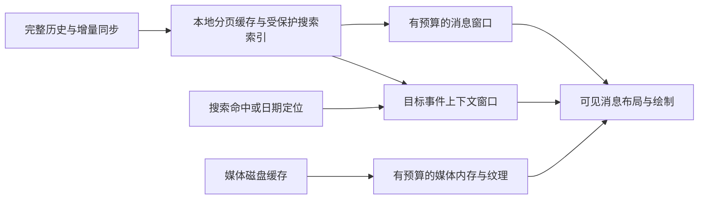

# Hagency Client 大规模聊天历史加载与渲染分析

日期：2026 年 10 月 20 日。

后续实施：用户已授权更新 main 并改进。最新实现与验证见 [聊天性能改进记录](client-chat-performance-improvements-2026-10-20.zh.md)。下文保留最初考察基线；已处理项目和剩余规模边界以实施记录为准。

当前 Client 已实现可见区域绘制、历史分页、滚动锚点恢复、部分增量更新和后台房间更新抑制。聊天窗口不会为了显示最近几十条消息而一次绘制百万条消息。但这些优化没有构成完整的内存和计算量边界：持续加载的历史、曾打开的房间、媒体缓存，以及搜索中的内存索引仍可能不断增长；部分消息更新仍遍历整个已加载时间线。

因此，可以确认“已有大列表优化基础”，不能确认“已达到百万、千万条历史下的稳定性能”。最需要补齐的是数据窗口和缓存预算、按事件直接定位、搜索索引，以及消息变化后的增量业务处理。仅调整虚拟列表参数不能解决这些问题。

考察对象为 `D:/Works/hagency-org/hagency-client`，主聊天实现位于 `crates/hagency-app`。Git HEAD 为 `f5f62ffbff6f8567de9d1a7318134289c2a43a9c`，以本次读取到的工作区源码为准；工作区存在其他任务的未提交修改。本次仅新增报告和项目记忆，没有修改产品代码，没有启动构建、操作用户会话或写入测试消息。结论来自源码和官方公开资料，未执行百万条真实负载测试；服务端数据库容量和查询执行计划不在本次性能认证范围内。

## 一 数据量需要分层看待

“有一千万条消息”与“内存里有一千万条消息”是两件事。应区分：

| 数据层 | 合理职责 | 数据量增加时应保持的边界 |
| --- | --- | --- |
| 服务端历史 | 保存完整历史、鉴权、查询和同步 | 可以保存百万千万条，依赖索引和存储容量 |
| 本地磁盘缓存 | 保存已同步历史和搜索索引，减少网络访问 | 独立磁盘预算、可重建数据回收策略 |
| 内存消息窗口 | 保存正在浏览位置附近的数据 | 有固定条数或字节预算 |
| UI 控件和布局 | 绘制屏幕附近的消息 | 接近可见消息数加少量预加载 |
| 图片和视频资源 | 缩略图、解码图像、GPU 纹理 | 分别限制字节数、像素量和并发 |

成熟聊天体验依靠这些层共同工作。总历史增大，不应该迫使首屏和每帧的工作量同步增大。

以下用 N 表示完整历史条数，L 表示已加载到当前内存时间线的条数，V 表示可见条数，P 表示每批加载条数。现有虚拟列表主要控制 V；目前若干风险仍随 L 增长。UI 中还存在日期分隔符等虚拟项，协议事件也包含编辑、撤回等记录，因此事件数与最终可见消息数不完全相同。

## 二 当前实现已经有哪些优化

| 环节 | 已核对的实现 | 能解决的问题及边界 |
| --- | --- | --- |
| 聊天绘制 | `PortalList` 配合 `set_item_range`、`next_visible_item`，只为需要的索引填充并绘制控件 | 避免每帧绘制全部已加载消息；不限制消息模型本身的内存 |
| 历史加载 | 主聊天常规回翻请求为 50 个事件，调用 SDK 的 `paginate_backwards` | 避免一次请求完整历史；50 是批量参数，不是整个时间线容量 |
| 提前加载 | `reached_start_margin: 2`，视口不满时继续补页 | 用户接近顶部时请求旧消息，减少空白等待 |
| 加载状态 | `is_paginating`、待处理的到顶信号、到头状态、无进展停止和错误处理 | 避免常规滚动路径重复并发请求或无意义反复加载 |
| 滚动稳定 | 新数据插入前按 event ID 找回可见消息及像素偏移；底部可见时才自动跟随新消息 | 减少前插历史导致的跳动，兼顾向上阅读和新消息到达 |
| 局部内容更新 | 后台处理 SDK `VectorDiff`；UI 记录内容和头像已绘制范围，局部变化失效对应范围 | 避免所有可见消息都重新填充；前插和重置会清除范围状态 |
| 数据共享 | 时间线使用 `imbl::Vector<Arc<TimelineItem>>` | 快照和消息对象可以共享，不能将每次 `clone()` 等同于深拷贝全部消息 |
| 后台房间 | 应用层 subscriber 首次打开时启动；关闭后暂停普通内容快照发送，重开时按需补一个快照；上传进度去重 | 减少后台 UI 消息和重复进度更新；不是停止所有 SDK 同步或回收时间线 |
| 本地存储 | Matrix SDK SQLite store，应用选择低内存配置 | 避免把持久化全部交给内存；SQLite 页缓存预算不是整个进程预算 |
| 图片 | 按需请求缩略图、缓存结果，特定原图回退受大小条件约束；blurhash 有尺寸限制 | 减少图片下载和重复工作；还需独立的媒体总量与解码资源预算 |
| 其他列表 | 会话列表、房间历史结果、部分 Projects 和 Agents 列表也使用 `PortalList` | 多个页面已有绘制虚拟化，不能由此推断各自数据接口已经分页 |

主要证据：[聊天列表配置](/D:/Works/hagency-org/hagency-client/crates/hagency-app/src/home/room_screen.rs:873)、[可见消息绘制](/D:/Works/hagency-org/hagency-client/crates/hagency-app/src/home/room_screen.rs:1854)、[到顶加载](/D:/Works/hagency-org/hagency-client/crates/hagency-app/src/home/room_screen.rs:4196)、[异步分页](/D:/Works/hagency-org/hagency-client/crates/hagency-app/src/sliding_sync.rs:1029)、[后台更新抑制](/D:/Works/hagency-org/hagency-client/crates/hagency-app/src/sliding_sync.rs:5620)、[局部更新发送](/D:/Works/hagency-org/hagency-client/crates/hagency-app/src/sliding_sync.rs:5878)、[SQLite 配置](/D:/Works/hagency-org/hagency-client/crates/hagency-app/src/sliding_sync.rs:107)。

依赖还提供两项容易误读的优化：

- 锁定的 Matrix SDK UI 0.19.1 在 subscriber 中设置最多 20 个初始项的跳过逻辑，并在回翻时逐步减少跳过数量。应用首次打开房间还会主动请求一批 50 个事件。初始输出少，不代表 SDK 内部只存这 20 项，也不代表以后加载的数据被自动裁到 20 项。
- 锁定的 Makepad `1f3b1de` 中，`keep_invisible` 默认关闭，普通绘制结束后调用 `retain_visible()`，释放离屏控件。聊天页没有启用 `reuse_items`，源码注释说明是为避免 Html/TextFlow 回收后残留布局状态。因此这里的问题是滚动时重新创建控件的成本，不能误判为“所有滚过的控件都永久保留”。跨消息选择时另有保留选区控件的路径，需要单独验收。

依赖证据：[SDK 初始项与分页跳过逻辑](/D:/BuildCache/hagency-client/cargo/registry/src/index.crates.io-1949cf8c6b5b557f/matrix-sdk-ui-0.19.1/src/timeline/subscriber.rs:110)、[Makepad 离屏控件处理](/D:/BuildCache/hagency-client/cargo/git/checkouts/makepad-d00a25647c09e43e/1f3b1de/widgets/src/portal_list.rs:1004)。这些是只读核对的依赖源码，没有修改 Cargo 缓存。

## 三 大规模历史下的主要缺口

### 已加载消息和房间状态缺少统一回收预算

UI 的 `TimelineUiState.items` 和后台 subscriber 的 `timeline_items` 保存已加载的时间线；回翻持续向前插入数据。应用可以处理 SDK 发来的删除、截断或重置，但没有发现主动维持固定消息窗口或字节上限的策略。这与“已经有 `Truncate` 分支”并不等价。

隐藏房间后，UI 状态放回 `TIMELINE_STATES`，其中包含消息、媒体缓存和其他房间状态，便于下次恢复。这个容器没有 LRU、TTL 或容量预算；存在退出、离房和失效时的清理，但这些不是日常内存回收策略。后台 `ALL_JOINED_ROOMS` 还保留 `Arc<Timeline>`；主时间线在房间登记时就构建，首次打开时延迟的是应用层订阅任务。

Matrix SDK 的 event cache 确实实现了“无订阅者时收缩到最后一个块”，不能说 SDK 完全没有回收。但 timeline 构建时建立 event-cache 订阅，而应用仍保留 timeline；隐藏聊天仅修改打开标记。因此不能依赖“切走房间”自动满足 SDK 的无订阅者收缩条件。

实际影响是：一个房间持续回翻、长期接收消息，或依次浏览许多房间后，内存可能随保留的历史和房间数增长。具体占用和 SDK 其他缓存的变化仍需测量。

证据：[房间时间线构建和保存](/D:/Works/hagency-org/hagency-client/crates/hagency-app/src/sliding_sync.rs:4560)、[subscriber 生命周期](/D:/Works/hagency-org/hagency-client/crates/hagency-app/src/sliding_sync.rs:3077)、[UI 状态保存](/D:/Works/hagency-org/hagency-client/crates/hagency-app/src/home/room_screen.rs:4621)、[SDK 收缩条件](/D:/BuildCache/hagency-client/cargo/registry/src/index.crates.io-1949cf8c6b5b557f/matrix-sdk-0.19.1/src/event_cache/caches/room/state.rs:405)。

### 普通消息更新仍包含全量业务遍历

`timeline_subscriber_handler` 应用一批差异后，只要不是纯上传进度，就遍历当前全部 `timeline_items`，调用 Bot discovery；启用 `agent_chat` 时还会再遍历一次审批 ingest。即使相关功能对多数事件很快返回，也仍然发生遍历；审批路径还可能解析原始事件 JSON。

因此，“SDK 发的是增量差异”没有保证后续处理全部增量化。这里每批普通更新的工作量至少包含 O(L) 遍历，具体业务解析会增加常数成本。关闭房间后的 UI 快照抑制也没有跳过这两段遍历。

UI 更新后还会调用 `own_send_indices`，它从末尾扫描，有找到已读回执或己方消息时提前结束的优化，但最坏情况仍可扫描大量项目。滚动锚点恢复则在 `new_items` 中查找可见消息，最坏约 O(L × V)；常规向前加页时往往很快遇到原有锚点，不应把最坏复杂度当作每次实际开销。

优先方向是仅处理新增、替换及必要关联的事件，并维护可更新的 event ID 索引。编辑、撤回、重新解密和审批权限校验必须保留原有语义。

证据：[全时间线业务遍历](/D:/Works/hagency-org/hagency-client/crates/hagency-app/src/sliding_sync.rs:5859)、[审批事件解析](/D:/Works/hagency-org/hagency-client/crates/hagency-app/src/agent_chat/approval_runtime.rs:94)、[锚点查找](/D:/Works/hagency-org/hagency-client/crates/hagency-app/src/home/room_screen.rs:4920)、[发送状态查找](/D:/Works/hagency-org/hagency-client/crates/hagency-app/src/home/room_screen.rs:4994)。

### 远距离跳转仍可能逐批遍历中间历史

当前跳转先在本地附近查找，随后后台搜索已加载时间线；若目标仍不存在，就启动每批 50 个事件的向后分页，直到找到目标、到达历史起点、失败或取消。UI 的 `PaginationIdle` 搜索分支会继续请求下一批；这不是按目标 event ID 创建一个独立上下文窗口。

如果目标距离当前已有数据一百万个协议事件，按每批恰好返回 50 个事件估算，需要约 20,000 个逻辑批次；一千万个事件约 200,000 个批次。有些批次由本地缓存满足，不等于全部都是 HTTP 请求，但读取、处理和扩展时间线的总成本仍然过高。过滤和空页还会改变实际批次数。

适合的方向是：已知 event ID 时使用事件上下文窗口，并支持这个窗口两端分页；按日期跳转时先定位事件，再取上下文。Matrix 规范提供事件上下文接口，SDK 0.19.1 也已有 Event focus 类型，可优先验证它们与本项目加密、回复和实时尾部切换的兼容性。[Matrix 事件上下文规范](https://spec.matrix.org/latest/client-server-api/#get_matrixclientv3roomsroomidcontexteventid)。

证据：[UI 跳转请求](/D:/Works/hagency-org/hagency-client/crates/hagency-app/src/home/room_screen.rs:3447)、[后台查找及回翻](/D:/Works/hagency-org/hagency-client/crates/hagency-app/src/sliding_sync.rs:5651)、[搜索时继续分页](/D:/Works/hagency-org/hagency-client/crates/hagency-app/src/home/room_screen.rs:2490)。

### 历史搜索是内存扫描 还不是完整历史搜索索引

实际房间历史面板在 `room_history.rs`。另一个 `search_messages.rs` 中的全局搜索按钮仍为禁用 TODO，不能把两者混为一谈。

历史面板首次打开读取 1 页，每页最多 100 个事件；执行搜索或点击继续读取时，每轮最多读取 10 页。它按 Matrix cursor 顺序拉取并由 SDK 解密，在内存 `HistoryIndex` 中维护消息、编辑、撤回和去重信息。面板关闭会 reset 并释放该索引，下次搜索仍需要重新建立。

每页回来后，UI 线程插入事件并调用 `refresh`：`results()` 遍历全部已加载消息，克隆候选消息、匹配文本、应用编辑，然后对结果排序。搜索框变化也会重新筛选已有数据。虚拟列表只减少结果行绘制，不减少这些读取、JSON 处理、克隆和排序。

这意味着当前搜索只覆盖已经检查过的历史。界面显示“Older history is available”也是这个边界的体现。要检查一百万个事件，按每页 100 个事件估算约需 10,000 页；一千万个约需 100,000 页。每页重新扫描累计数据，还会产生近似 O(N²/P) 的累计扫描成本，另有结果排序成本。这条路径不适合百万级全文检索。

适合的方向是建立可增量维护的本地持久搜索索引，查询在工作线程执行，结果分页返回，明确已索引覆盖范围。加密房间需要在本机解密后索引，并设计索引保护、账号隔离、缺失密钥、编辑和撤回的更新方式。不能假设服务端可直接搜索端到端加密正文。中文分词和搜索语义也需要专门验证。

证据：[内存历史索引](/D:/Works/hagency-org/hagency-client/crates/hagency-app/src/home/room_history.rs:128)、[查询扫描与排序](/D:/Works/hagency-org/hagency-client/crates/hagency-app/src/home/room_history.rs:227)、[cursor 加载](/D:/Works/hagency-org/hagency-client/crates/hagency-app/src/home/room_history.rs:399)、[每页 UI 更新](/D:/Works/hagency-org/hagency-client/crates/hagency-app/src/home/room_history.rs:617)、[搜索批次](/D:/Works/hagency-org/hagency-client/crates/hagency-app/src/home/room_history.rs:680)。

### 媒体缓存仍需要独立预算

应用 `MediaCache` 用 HashMap 保存缩略图和原文件的 `Arc<[u8]>`，全局头像缓存也保存已加载字节；没有发现按总字节数淘汰成功条目的策略。清理 pending 和 failed 请求不是回收已加载媒体。时间线状态长期保存时，其媒体缓存也会继续存在。链接预览有按年龄清理的机制，但“超过 100 条后尝试清理一小时前的条目”不是严格的 100 条容量上限。

图片网络下载异步，也不意味着绘制阶段没有解码成本：图片加载入口和 blurhash 解码出现在消息内容填充路径中。已有缓存和 blurhash 尺寸限制，但仍需测量大量图片首次进入视口时的 CPU 和纹理占用。压缩文件字节、解码像素、GPU 纹理必须分别计量。

证据：[媒体缓存模型](/D:/Works/hagency-org/hagency-client/crates/hagency-app/src/media_cache.rs:8)、[头像缓存](/D:/Works/hagency-org/hagency-client/crates/hagency-app/src/avatar_cache.rs:11)、[预览缓存清理](/D:/Works/hagency-org/hagency-client/crates/hagency-app/src/home/link_preview.rs:603)、[图片填充与 blurhash](/D:/Works/hagency-org/hagency-client/crates/hagency-app/src/home/room_screen.rs:6228)。

### UI 队列与复杂内容仍可能造成卡顿

时间线内容通过无界 channel 发送，UI 的 `process_timeline_updates` 用 `try_recv()` 循环处理，未设置每帧处理时间或条数预算。高频消息、解密或 UI 暂时繁忙时，可能积压多个快照并在恢复后集中处理。快照共享结构，不能按“快照数乘全部正文”计算内存，但排队仍会保留历史版本和处理工作。

另外，可见消息数量少也不能保证每帧固定耗时。长文本、复杂 HTML、图片尺寸变化和多消息选择都有额外成本；清理显示范围或隐藏事件使用零高度 Empty 项时，也可能连续访问许多不显示的索引。应将文本布局、内容解析、隐藏项遍历和滚动选择列为独立压测场景。

证据：[无界时间线 channel](/D:/Works/hagency-org/hagency-client/crates/hagency-app/src/sliding_sync.rs:4572)、[UI 队列处理](/D:/Works/hagency-org/hagency-client/crates/hagency-app/src/home/room_screen.rs:2180)、[清理范围与隐藏行](/D:/Works/hagency-org/hagency-client/crates/hagency-app/src/home/room_screen.rs:1869)。

会话列表还需单独评估房间数量：虽然绘制虚拟化，但排序或重新生成显示集合仍可能扫描、排序所有房间。“单房间千万条消息”与“十万个房间”是不同瓶颈。[会话列表生成](/D:/Works/hagency-org/hagency-client/crates/hagency-app/src/home/rooms_list.rs:1332)。

## 四 Telegram 和 Slack 能确认的做法

### Telegram

Telegram 的 `messages.getHistory` 通过消息 ID、日期、数量等参数获取历史片段；完整历史无需一次传到客户端。[官方历史 API](https://core.telegram.org/method/messages.getHistory)。

Telegram Desktop 公开源码中，`HistoryInner::enumerateItemsInHistory` 先排除不可见历史区域，再对消息块和块内项目二分定位可见边界，随后只枚举覆盖可见范围的消息；`repaintItem` 可以只重绘消息对应区域。这是原生客户端按可见范围绘制的具体实现，不依赖浏览器 DOM。[Telegram Desktop 聊天绘制源码](https://github.com/telegramdesktop/tdesktop/blob/dev/Telegram/SourceFiles/history/history_inner_widget.cpp)。

Telegram 的更新协议还明确维护已知消息范围、更新位置和缺口；浏览到缺口时补取对应范围。分页不仅是“不断往数组头部追加”，还需要知道哪些区间已经同步、哪些区间有缺口。[Telegram 更新和消息范围机制](https://core.telegram.org/api/updates)。

这些资料能证明其分页、可见区定位和范围同步设计，不能据此断言所有 Telegram 平台都有完全相同的内存上限或缓存策略。

### Slack

Slack 官方工程文章记录了从启动时预取许多频道，转向按需获取频道消息、减少每页消息、根据用户操作提前加载的过程。2017 年文章给出的历史参数是每页 42 条；它说明的是当时的设计选择，不能当作 2026 年各端仍固定使用的数值。[Slack 按需加载实践](https://slack.engineering/making-slack-faster-by-being-lazy/)。

Slack 也公开过将长时间未查看的团队切换为轻量后台客户端，只保留未读和通知等必要状态，以回收完整界面的资源。这是后台工作集应当回收的实际案例。[Slack 内存回收实践](https://slack.engineering/reducing-slacks-memory-footprint/)。

当前公开 `conversations.history` API 提供 cursor 和时间范围分页；线程消息另有 `conversations.replies`。这是第三方公开 API 的能力说明，不等于 Slack 自有客户端内部接口或其限流策略。[Slack 历史 API](https://docs.slack.dev/reference/methods/conversations.history/)、[Slack 线程 API](https://docs.slack.dev/reference/methods/conversations.replies/)。

Slack 还公开过用虚拟列表减少 Emoji Picker DOM 节点的案例；该资料证明虚拟化在其产品中的使用，但不足以确认当前聊天窗口采用哪个虚拟列表库或多少条 overscan。[Slack Emoji Picker 虚拟列表案例](https://slack.engineering/rebuilding-slacks-emoji-picker-in-react/)。

对 Hagency 最有价值的共同方向是按需读取、只绘制视口、限制后台工作集，并让跳转和搜索直接定位所需片段。这里的完整目标方案是结合本项目的工程建议，不是把某一公司的未公开实现当作事实复述。

## 五 百万千万条历史应该如何支持

建议保留现有 Rust、Makepad 和 Matrix 体系，先为每层增加明确边界。无需仅因为历史多就更换 UI 框架。

消息窗口应保存 `anchor_event_id + pixel_offset`、两端分页位置和已知区间。向上翻页时加载上方片段，超预算后回收远离视口的数据；向下返回时可重新读取。历史上下文窗口与实时尾部分开管理，收到新消息只更新尾部和未读状态，不把用户从旧消息位置拉走。

裁剪必须覆盖 SDK timeline、event cache、应用 subscriber 和 UI 状态的生命周期。只在 UI 侧截断数组，后台仍持有完整 timeline，就无法真正控制总内存。需要先验证 SDK focus 切换、drop 和重建语义，再决定窗口适配方式。

可先用以下参数作为实验起点，而非已经验证的最终配置：

| 资源 | 初始实验策略 | 验证重点 |
| --- | --- | --- |
| 单活动消息窗口 | 约 500 至 2,000 项，并加字节上限 | 长消息、引用、重新解密、来回滚动 |
| 最近房间完整状态 | 约 5 至 10 个，再按最近访问回收 | 未读和通知不依赖完整 timeline 常驻 |
| 历史分页 | 保留每批 50 的起点，按耗时和可见密度调节 | 弱网、过滤后无可见消息、取消和去重 |
| 媒体内存 | 依据目标设备设全局字节与像素预算 | 缩略图、原图、解码图像和 GPU 分开统计 |
| 内容更新 | 合并可替代的内容快照，按帧预算消费 | 审批结果、错误、发送状态等不可丢事件保序 |
| 搜索 | 磁盘索引查询，首批返回有限结果 | 中文、加密历史、覆盖范围、编辑和撤回 |

服务端查询应按房间与稳定顺序键建立合适索引，以 cursor 或键范围翻页，避免深 OFFSET；但必须核对实际 Hagency Server 查询与执行计划后再认定服务端已有这些保证。本地 SQLite 也需要独立的大数据库查询和索引测试。

内存估算只能用于说明数量级：假设每条已解码消息及元数据平均 2 KiB，100 万条约 1.9 GiB，1,000 万条约 19 GiB，还不含媒体和其他状态。2 KiB 是假设，不是本项目测量结果；Arc 共享也不会让这些实际持有的对象变成零占用。相比之下，将完整历史留在磁盘，仅保留少量活动窗口，才有机会让 RAM 随工作集而非总历史增长。

## 六 建议顺序与验收标准

| 顺序 | 工作 | 完成后应达到的效果 |
| --- | --- | --- |
| 1 | 建立真实观测，去掉普通更新中的全量 ingest，加入窗口、后台房间和媒体预算 | 历史翻得更深、房间切得更多后，内存可以收敛；新消息成本不随全部历史增长 |
| 2 | 支持 event context 和日期定位，维护稳定事件索引 | 跳到多年前消息无需遍历全部中间历史 |
| 3 | 建立受保护的本地搜索索引和分页结果 | 已索引百万级历史查询不再从网络起点逐页扫描 |
| 4 | 内容快照合并、UI 帧预算、复杂消息布局和控件回收优化 | 高并发消息和图文滚动时保持响应 |
| 5 | 以同样方法审计会话、成员、Projects、Agents 和日志列表的数据接口 | 其他页面同时具备绘制与数据规模边界 |

控件复用应在 Html/TextFlow 重置问题得到验证后开启，不能直接取消现有保护。消息历史裁剪、搜索索引和审批 ingest 的变更需要同时验证编辑、撤回、回复、线程和重新解密，避免性能提升破坏消息语义。

后续压测应将“磁盘总历史量”和“活动内存窗口”分别变化。建立 1 万、10 万、100 万、1,000 万条历史数据集；同时覆盖冷缓存、热缓存、已索引与未索引状态，不以构造百万条内存 Vec 代替真实存储链路。

至少覆盖最近消息首屏、连续上翻和反向返回、搜索后跳到旧消息、后台多个房间持续收消息、长文本和图文混排、编辑撤回、解密补齐、跨消息选择，以及运行数小时后的内存回收。

需要记录首屏时间、分页 P50/P95/P99、UI 帧时间、最长主线程阻塞、活动消息及房间数、队列长度、进程内存、媒体和纹理字节，以及查询扫描行数。60 Hz 的每帧总预算约 16.7 ms；这是目标预算，不能用“平均帧率不错”掩盖间歇性长卡顿。

百万级支持的关键验收条件应是：增加完整历史 N 后，最近消息首屏和帧时间不出现随 N 线性增长的趋势；持续滚动和切房后，内存落在明确预算内；旧消息跳转和已索引搜索依靠直接定位；索引不完整或历史无法解密时如实显示范围。当前源码尚未提供这些规模下的实测结果。
