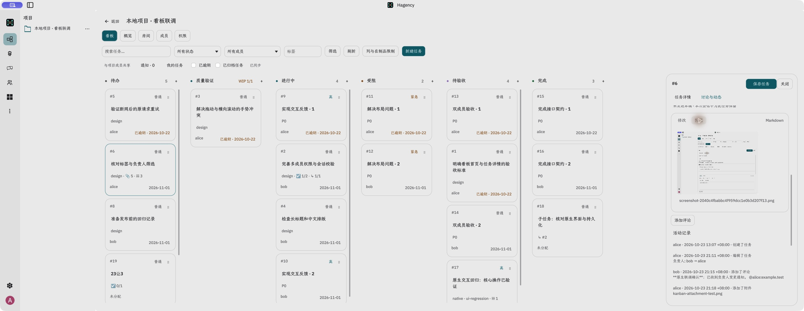
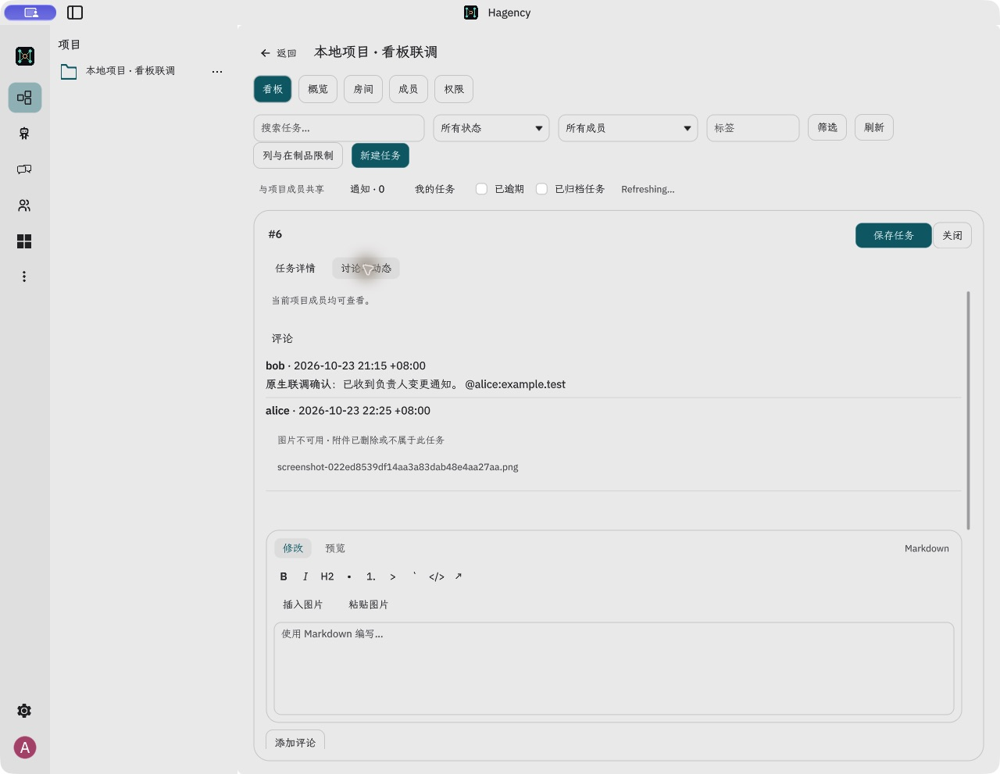

# 项目看板图片编辑与附件验证（2026-10-23）

## 交付范围

Client 和 Server 均在 `codex/project-kanban`。Cloud 无改动，未部署或推送。

- 描述、评论的 Markdown 工具栏增加“插入图片”和“粘贴图片”；编辑框支持 Cmd/Ctrl+V 剪贴板图片，普通文本粘贴保持原行为。
- 文件拖入附件区可添加附件；拖入描述/评论编辑区可上传 PNG/JPEG 并插入图片引用，提供目标边框和释放提示。多文件串行处理，切卡后的异步结果不能污染其他草稿。
- 图片保存为受当前项目成员权限保护的附件；Markdown 使用 `attachment:att_…`，不依赖临时本地路径，也不自动加载远程图片。
- 上传只更新附件及当前草稿，不自动保存描述或发布评论。保留 UTF-8 选区、原生撤销和上传期间的新编辑。
- 附件行分为文件名和大小/操作两行，提供预览、下载、删除。删除有文件名与引用失效说明及取消入口；已删除图片显示可理解的占位，正文保留。
- 每个文件不超过 2 MiB，每个任务最多 20 个活动附件。内嵌图片解码有像素/内存限制，缩略图最多 1024px。当前插图格式为 PNG/JPEG。
- Server 上传回执增加稳定的附件 ID，幂等重试返回同一 ID。

## 实测发现并修复

1. 上传期间编辑器只读，ACK 后直接调用原生插入会失败：先解除临时写锁，再以原生编辑/撤销操作插入。
2. NativeOwner 的 board-command 原先只有 128 KiB 请求额度，导致小图成功、截图失败。现在附件上传允许与 2 MiB 文件一致的编码请求额度（外层 3 MiB），其他操作仍限制 128 KiB。边界测试覆盖最大合法编码和超大普通请求。
3. 刷新同一任务时清空评论会压缩滚动区域，使上传后的编辑位置跳到顶部：保留同任务历史直至新数据到达；切卡先清空。保留当前编辑/预览模式，相同 Markdown 不重复重建 HTML。
4. 逾期卡片文本反复切换、重复按钮状态写入、空闲拖动浮层重复 hide 会请求额外重绘：增加变更判断和绘制缓存，并补静态卡片/空闲浮层回归。

## 完整原生客户端实际操作

使用 `/tmp/HagencyLocal.app`，通过正常 Projects → 本地项目详情 → 看板 → 任务 #6。连接本地真实 Server/PostgreSQL（127.0.0.1:55474 / 55473）；登录与 Matrix 身份由明确的本地测试夹具提供，不等于生产身份系统的端到端验证。

| 操作 | 结果 |
| --- | --- |
| 原生文件选择器插入描述图片，预览、保存、重启重开 | 通过；原有描述保留 |
| 剪贴板图片经“粘贴图片”插入评论，预览、发布 | 通过 |
| Preview 复制真实客户端截图，在评论框 Cmd+V | 通过；修复 128 KiB 转发限制后保存了 277,823 字节 PNG |
| 截图 Markdown 预览并发布评论 | 通过；附件和正文引用持久化 |
| 删除附件取消 | 通过，附件保留 |
| 删除已被评论引用的测试图片 | 通过；活动附件移除，评论保留并显示不可用占位 |
| 宽屏看板及窄屏完整详情布局 | 已实际查看 |
| Finder 跨窗口拖放 | **未验证通过**；CUA 多次操作未产生客户端根入口 Drag/Drop 事件，部分窗口返回 windowNotFoundAtPosition。操作者已确认稍后手动复核，不能用事件级测试替代这项实测 |

原生界面证据：

## 自动验证

- App 全量 lib：607 passed / 0 failed / 2 既有 ignored。
- 后续同任务刷新修复后的看板专项：29 passed / 0 failed，包含文件 Drag 命中、Copy 响应、取消高亮、草稿/异步范围隔离、刷新保留内容、绘制回归。
- NativeOwner 新增请求边界测试与同模块测试：3 passed。
- App 严格 Clippy（`--no-deps --lib --tests -- -D warnings`）通过。包含依赖的 Clippy 会命中既有 article-makepad lint，不混作本次源码检查通过。
- Server 全新一次性 PostgreSQL 数据库全部 lib 测试：90 passed / 0 failed / 0 ignored；严格 all-target Clippy 通过。
- OpenAPI：77 个 owner 操作和 4 个 appservice 操作校验通过。
- i18n：2370 条目、1787 调用点、0 缺失。

## 已知边界

- Finder 真实跨窗口拖入仍需人工复核；未宣称该项已通过。
- 原生调试版在项目列表页面也存在较高 CPU 和重复资源日志，本次修复了看板自身发现的重绘点，未宣称整个客户端性能问题全部解决。
- 草稿继续遵循已有会话内、账号/项目/任务隔离策略；不是跨重启草稿持久化。
- 内嵌图片展示缩略图，附件仍可下载原文件；不包含富文本 WYSIWYG、任意外链图片抓取、图片裁剪或相册管理。
